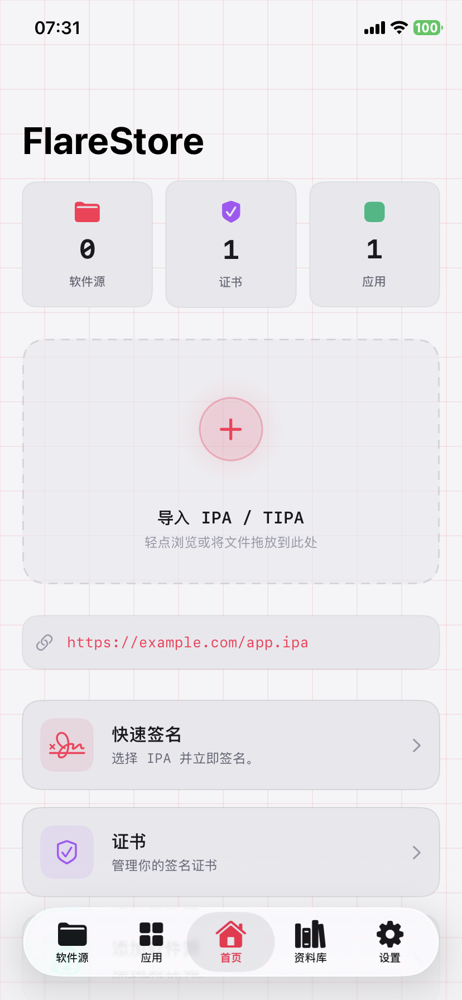
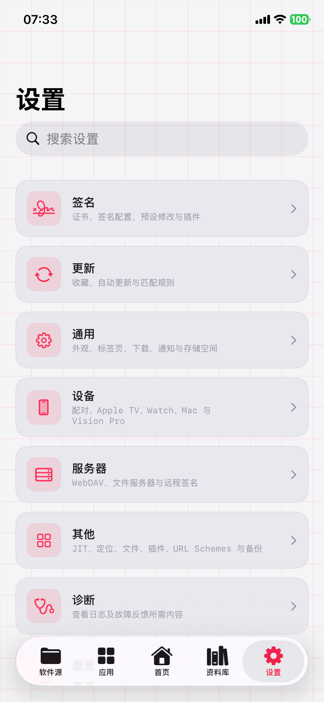
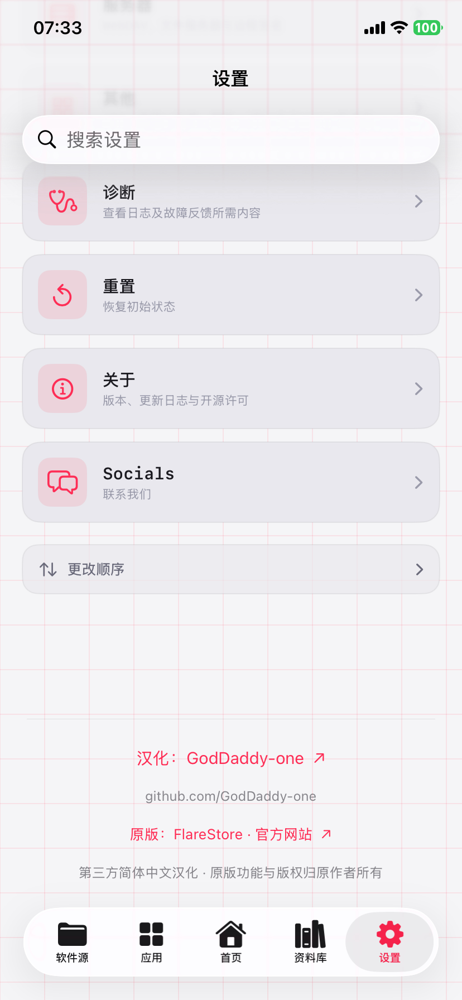

# FlareStore 中文版

FlareStore iOS / iPadOS 简体中文汉化 · 原版 1.5.0（54）

**[下载中文版](https://github.com/GodDaddy-one/FlareStore-ZH/releases/latest) · [原版官网](https://flarestore.app/) · [反馈汉化问题](https://github.com/GodDaddy-one/FlareStore-ZH/issues)**

这是 FlareStore 的第三方简体中文汉化版本，方便中文用户使用 IPA 导入、签名、安装和资料库管理等功能。软件原版由 **FlareStore 团队**开发，汉化与发布维护由 **[GodDaddy-one](https://github.com/GodDaddy-one)** 提供。

## 下载安装

前往 **[Releases](https://github.com/GodDaddy-one/FlareStore-ZH/releases/latest)**，展开页面底部的 **Assets** 下载 `.ipa` 附件。安装包以 Release 附件形式提供。

| 附件 | 用途 |
| --- | --- |
| `FlareStore-1.5.0-54-ZH-Unsigned.ipa` | 已集成汉化和设置页 GitHub 署名的完整未签名包，需要自行签名后安装。 |
| `SHA256SUMS.txt` | 下载文件的 SHA-256 校验值。 |
| `FlareStoreZH-1.2.0-Source.zip` | 汉化插件源码、词库及构建说明。 |

1. 下载未签名 IPA，使用自己的有效证书和描述文件重新签名。
2. 签名时保留 **4 个扩展和 Watch App**，并对新增动态库及各组件完成签名。
3. 安装后打开“设置”，滑至最下方，可看到 **“汉化：GodDaddy-one”**；点击直接打开 GitHub 主页。

覆盖安装前请备份资料。能否保留应用数据取决于签名后的应用标识、团队和系统状态。

## 软件能做什么

| 功能 | 说明 |
| --- | --- |
| IPA 导入与资料库 | 从本地文件或链接导入 IPA，集中浏览和管理应用。 |
| 签名与安装 | 管理证书和描述文件，签名 IPA，并通过应用内安装流程安装到设备。 |
| 软件源 | 支持添加 AltStore、SideStore、ESign 格式的软件源，浏览和下载应用。 |
| 签名前编辑 | 按原版能力修改应用名称、Bundle ID、图标等选项。 |
| 更多工具 | 保留原版 JIT、配对、备份和开发者定位等相关入口；使用条件依设备、系统和签名权限而定。 |

基础功能和安装流程可参阅 [FlareStore 官方介绍](https://flarestore.app/app/) 与 [iOS / iPadOS 官方指南](https://flarestore.app/guide/ios/)。本仓库提供 iOS 汉化包；Mac 用户请到 [macOS 中文版仓库](https://github.com/GodDaddy-one/FlareStore-macOS-ZH)。

## 应用内截图

<table>
<tr><th>首页</th><th>设置</th><th>设置底部 · 汉化署名</th></tr>
<tr><td></td><td></td><td></td></tr>
</table>

截图来自 iPhone 11 的实际应用界面。

## 汉化内容

- 内置 2,483 条精确翻译，覆盖资料库、软件源、签名、证书、安装、设置、配对等常见界面。
- 在**应用内“设置”页最下方**加入汉化署名、GitHub 主页链接及原版官网链接。
- 保留原版主 App、4 个扩展和 Watch App。
- 汉化词库随插件内置，无需联网翻译。

仍可能出现英文，包括动态内容、网页、系统弹窗和独立扩展界面。词条数量不代表所有页面均已完整翻译。

## 兼容与验证

- 对应原版：**FlareStore 1.5.0（54）**；最低系统：**iOS / iPadOS 16.0**。
- 汉化插件仅在匹配的主程序版本中启用，其他版本需要重新适配。
- 此前完整汉化包已在 iPhone 11 / iOS 26.6.1 上验证安装、启动、手机端签名安装，以及开发者定位的开启与停止恢复。
- 本次设置页署名已在 iPhone 11 真机验证显示，并点击打开 GitHub 主页；详细记录见 [验证说明](docs/VALIDATION.md)。
- Apple Watch 运行、其他设备、其他证书及所有系统版本未逐一实测。

需要定位或 JIT 时，请遵循原版说明完成配对和系统授权。定位所用 FlareQuic 隧道会占用设备当前 VPN 连接，结束时先停止定位。

## 原版出处与致谢

- **原版软件与开发团队：** [FlareStore](https://flarestore.app/)
- **官方应用下载与介绍：** [flarestore.app/app](https://flarestore.app/app/)
- **官方更新日志：** [Changelog](https://flarestore.app/changelog/)
- **中文汉化与发布维护：** [GodDaddy-one](https://github.com/GodDaddy-one)
- **汉化插件使用的第三方代码：** [facebook/fishhook](https://github.com/facebook/fishhook)，BSD 许可证，原始许可保留在源码内。

本项目为非官方汉化，与 FlareStore 官方无隶属关系。原版软件名称、图标、功能和相关权利归各自权利人所有；本仓库不为原版软件另行授予开源许可。汉化不包含付费权益解锁，证书与账号服务仍遵循原版规则。

## 问题反馈

汉化问题请提交 [Issue](https://github.com/GodDaddy-one/FlareStore-ZH/issues)，附页面截图、原英文、期望译文、系统版本和应用版本。请遮挡证书、设备标识、账号等个人信息。原版服务或付费证书问题请联系 [FlareStore 官方](https://flarestore.app/contact/)。
